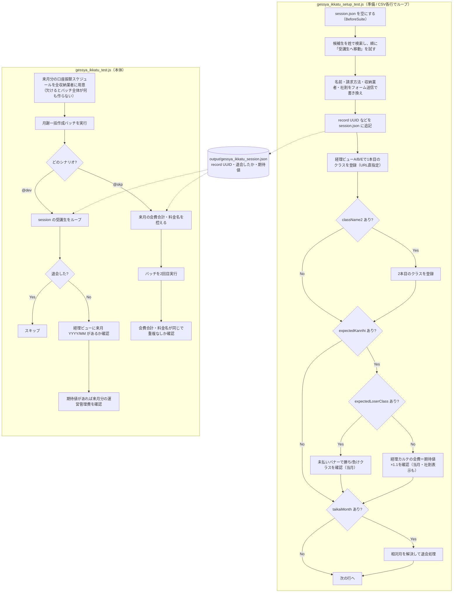

# 月謝一括作成テストの流れ（準備 → バッチ実行 → 来月分の料金を検証）

> - **何の資料か**: 月謝一括作成の E2E テスト2本が、どんなデータを作り、何をどの順で確かめているかの解説
> - **対象テスト**: `codecept/tests/shimamura/flow/gessya_ikkatu_setup_test.js`（準備）＋ `codecept/tests/shimamura/flow/gessya_ikkatu_test.js`（本体）
> - **最終更新**: 2026-10-15（初版 2026-07-07。`/flow-explain` で作成）
> - **参照したファイル**:
>   - Page Object: `codecept/pages/shimamura/flow/GessyaIkkatuFlowPage.js`
>   - 共通ステップ: `codecept/pages/shimamura/_common/KouhoseiSteps.js`（候補生 → 受講生）・`KeiriViewSteps.js`（経理ビュー）・`TaikaiSteps.js`（退会）
>   - 前提づくり: `codecept/support/shimamura/accountTransferSchedule.js`（口座振替スケジュール）・`codecept/support/shimamura/editViewSubmit.js`（フォーム送信）
>   - CSV: `codecept/data/shimamura/gessya_ikkatu_setup_data.csv`
> - **業務の仕組み**は `docs/shimamura/concepts/月謝一括作成の概念.md`・`運営管理費の概念.md` を参照

---

月謝一括作成画面のバッチを実行し、**テスト用に用意した受講生に来月分の月謝（運営管理費を含む）が正しく作られるか**、
さらに**バッチを2回実行しても料金が重複しないか**を確かめるテスト。
受講生を用意する「準備」と、バッチを実行して確かめる「本体」の **2ファイルが JSON ファイルでつながる** 構成になっている。

## 30秒でつかむ

- 準備テストは、CSV の1行ごとに**既存の候補生を受講生に昇格**させ、請求方法とクラスを設定する（受講生を新しく作るわけではない）
- 用意した受講生の record UUID を `output/gessya_ikkatu_session.json` に書き、本体テストがそれを読む
- 本体テストのシナリオは2つある
  - `@dev`: バッチを1回実行し、来月分の料金があるか確かめる
  - `@skp`: バッチを2回実行し、料金が重複していないか確かめる
- バッチは **testgcp 全体**にかかる。また、来月分の口座振替スケジュールが1つでも欠けていると、全員分が作られない（#169）

## 全体の流れ

```
gessya_ikkatu_setup_test.js  … CSV 1行＝受講生1人を用意（昇格・請求方法・クラス登録・退会など）
        ↓ output/gessya_ikkatu_session.json（record UUID・退会したか・運営管理費の期待値）
gessya_ikkatu_test.js
  ├ @dev  … バッチ1回 → 各受講生の経理ビューに来月分があるか・運営管理費が正しいか
  └ @skp  … バッチ2回 → 1回目と2回目で来月分の会費合計・料金名が同じで、重複が無いか（#166）
```

- 準備テストは最初に（`BeforeSuite`）session ファイルを空にする。準備テストを流し直すと、前回の受講生は本体の対象から外れる
- 本体テストは session の **record UUID で受講生を直接開く**。同じ名前の受講生が何人いても取り違えない

## データソース: `codecept/data/shimamura/gessya_ikkatu_setup_data.csv`

1行＝**受講生1人＝1シナリオ**（いまは10行）。`Data(csv).Scenario(...)` で全行を回す。

| 列 | 役割 | 空欄なら |
|---|---|---|
| `scenario` / `testNo` | シナリオ名・連番。受講生の名（例: `001銀行引落スクール`）にも使う | — |
| `lastName` | 昇格させる**候補生**を探す姓（いまは「かげやま」） | — |
| `bank_payment_type` / `shima_storage_id` | 請求方法（1=銀行引落 / 2=イオンCカード）・収納業者 | — |
| `className` / `courseCategory` / `keiyakuDate` / `kaishiDate` | 1本目のクラス・分類（スクール/サロン）・契約日・開始日 | — |
| `className2` / `courseCategory2` / `keiyakuDate2` / `kaishiDate2` | 2本目のクラス（掛け持ち＝UNN パターン） | 2本目を登録しない |
| `taikaiMonth`（`taikaiYear`） | 退会する月。`先月` / `今月` / `来月` と相対で書ける | 退会しない |
| `expectedKanrihi` / `expectedWinnerClass` | 運営管理費の期待値（税抜）と、その額を取るはずのクラス | 運営管理費を確かめない |
| `expectedLoserClass` | 同額のとき負けるはずのクラス（同額 tie-break パターン） | 通常の最大額チェックにする |
| `discount` | `1` なら社割 ON（運営管理費0円・社割「あり」表示を確かめる） | 社割なし |

## 受講生の「用意のしかた」（ここが肝）

コードを読まないと気づきにくい点を先に挙げる。

1. **受講生を新しく作っていない。既存の候補生を昇格させて使う**
   - `KouhoseiSteps.navigateToKouhosei` は、候補生一覧を `lastName` で検索し、先頭から順に「受講生へ移動」を試す
   - 昇格できない候補生は飛ばす
   - 会員番号の重複エラーが出たら、確認用 SQL を添えて止まる（DB 側の問題のため）
   - 全員だめなら「候補生データを補充してください」で止まる
   - **1回流すと候補生を10人使う**（候補生は年1回 DB に直接入れるデータで、画面からは作れない）
2. **名前・請求方法は画面操作ではなくフォーム送信で書き換える**（`editStudentPaymentBySubmit`。#236）
   - 姓は `月謝テスト{MMDD}`、名は `{testNo}{scenario}` にする
   - メモには「実行日時＋シナリオ」を残す（`buildTestName`）。同じ名前になるのを避けつつ、後から探せる
3. **CSV の日付は古くてもよい**
   - 契約日・開始日が過去の月なら、`resolveDynamicDateIfPast` が今日の日付に直す（画面が「当月以降」しか受け付けないため）
   - そのため、CSV を毎月書き直さなくてよい
4. **経理ビューは URL で直接開く**
   - 受講生の UUID が分かっているので、`openKeirisyoriScreenA(..., { recordId })` で開く（サイドバー経由より約8秒速い。#244）
   - 2本目のクラスは、1本目の確認完了で経理ビュー A に戻っているので `skipNav: true` で続ける
5. **session ファイルの中身**
   - 1人ごとに次を1件ずつ書く
     - `recordId`・姓名・`scenario`
     - `withdrawn`（`taikaiMonth` が埋まっていれば true）
     - `expectedKanrihi`・`expectedWinnerClass`

### 準備テストの条件分岐（CSV の列で処理が増える）

- `className2` あり → 経理ビュー A/B/E をもう1回通して2本目を登録する
- `expectedKanrihi` あり → **その場（当月分）**で運営管理費を確かめる
  - `expectedLoserClass` あり（同額 tie-break）→ 未払いバナーのクラス別内訳で、勝つクラスに満額が残り、負けるクラスが相殺されて0円になることを確かめる（`verifyKanrihiWinnerByClassName`）
  - なし → 経理カルテ（`#tbl_carte`）の当月の会費が期待値の税込（×1.1）と一致することを確かめる（`verifyKanrihiFee`）。`discount=1` なら社割「あり」の表示も確かめる
- `taikaiMonth` あり → 相対月（先月/今月/来月）を年月に直し、退会処理をする（`TaikaiSteps.executeTaikai`）

## 実行と検証（本体テスト）

### 前提: 来月分の口座振替スケジュールを先に用意する

`runMonthlyFeeCreation` は、バッチの前に `ensureAccountTransferSchedules` を呼ぶ。
収納業者ごとに、来月分の口座振替スケジュール（引落日11日・入金日15日）を登録する。
**収納業者が1つでもスケジュール未登録だと、その業者の分だけでなく処理全体が何も作らない**仕様のため（#169 の原因）。

その後、月謝一括作成画面のボタンを押し、確認ダイアログを承認して、サーバーの処理が終わるまで（networkidle、最大60秒）待つ。

### シナリオ1（`@dev`）: 来月分が作られたか

session の受講生を順に見ていく（退会した人は飛ばす）。

1. 受講生詳細を UUID で開き、サイドバーから経理ビューへ移る（ここはサイドバー経路のまま）
2. 来月の `YYYY/MM` が画面にあることを確かめる
3. `expectedKanrihi` と `expectedWinnerClass` があれば、**来月分にも最大額の決まり方が効いているか**を経理カルテで確かめる
   - 同額 tie-break は来月分では確かめない
   - 未払いバナーは当月以前しか出ないため

### シナリオ2（`@skp`）: 2回実行しても重複しないか（#166）

1. バッチ1回目を実行する
2. 受講生ごとに、来月の「会費合計」（経理カルテの月の行）と「料金名の一覧」（月リンク先の料金一覧）を控える。1回目で料金が無ければその時点で失敗にする
3. バッチ2回目を実行する
4. 会費合計と料金名が変わらず、同じ料金名が2つ無いことを確かめる（`assertNoDuplicateFees`）

## フローチャート



## つまずきやすい点

| 症状 | 原因 | 対処 |
|---|---|---|
| 準備テストが「有効な候補生が見つかりませんでした」で止まる | 「かげやま」の候補生を使い切った | 候補生を補充してもらう（UI では作れない） |
| 本体の `@skp` が「確認できる受講生がいません」で止まる | session が空、または全員退会のシナリオだった | 準備テストを先に流す |
| バッチ後に来月分が誰にも作られていない | どこかの収納業者の来月の口座振替スケジュールが無い | `ensureAccountTransferSchedules` が通っているかログを見る。登録画面のエラーも確認する |
| 運営管理費が期待値と合わない | 期待値は税抜で、画面は税込 | 比較は ×1.1 で行っている。テスト用クラスの月謝が0円か（会費＝運営管理費になる前提）を確認する |
